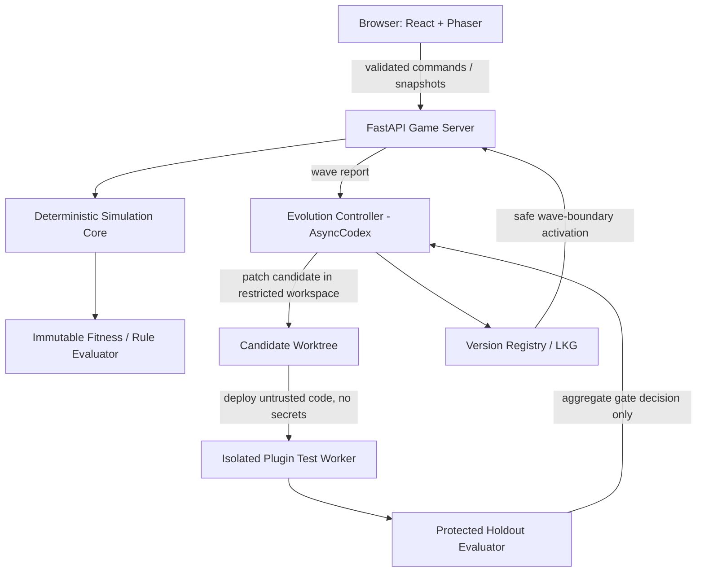

> **Planning update (2026-10-23):** Event is **1 day with 7 judged hacking hours**, not the originally assumed 3 days. This document describes target architecture/test coverage; any missing implementation must be marked honestly. See `docs/SPRINT_PLAN.md`.

# Architecture and Contracts — proposed, not implemented

## Context and trust boundaries



Separate protected evaluator from Codex/candidate file system and runtime. No hidden seeds, evaluator code or credentials in patch workspace. A diagram is an intent, not evidence of implementation.

## Primary domain types (illustrative contract)

```ts
interface ObservationV1 {
  waveId: string;
  simulationTick: number;
  stateVersion: number;
  visiblePatients: PatientView[];
  visibleResources: ResourceView[];
  currentEvents: EventView[];
}

type GameCommandV1 = {
  command_id: string; // idempotency key scoped to game
  actor_id: string;
  expected_state_version: number;
  action: 'assign_staff' | 'allocate_bed' | 'prioritize_queue' | 'request_transfer';
  payload:
    | { type:'assign_staff'; patient_id:string; staff_id:string }
    | { type:'allocate_bed'; patient_id:string; bed_id:string }
    | { type:'prioritize_queue'; patient_id:string; new_priority:number }
    | { type:'request_transfer'; patient_id:string; destination_id:string };
};

interface StrategyPluginV1 {
  decide(o: ObservationV1): GameCommandV1[];
}
```

**Contract refinements before coding:** Use a discriminated `action`/`payload.type` that must match; generated Pydantic/OpenAPI TypeScript schemas are canonical. AI command actor attribution must be controlled by server (not arbitrary user-supplied id). Set allowable queue-priority domains, source/destination capacity and staff qualifications in immutable game rules. This example intentionally does not claim a complete valid production type system.

## Command handling
1. Authenticate origin/role (the Game Server, not the client, assigns trusted identity for AI and protected controller requests).
2. Parse typed discriminated payload; reject mismatched action/payload types.
3. Check unique command id (if previously committed, return original outcome; avoid double apply).
4. Under a single atomic transaction / serialized tick, compare expected state version and check available staff/beds, permissions and simulated safety.
5. Apply or reject; increment version on accepted mutation only; append structured audit log with rule/version/cause.
6. Rejected request has no side effect. Replay from event sequence must preserve total order.

## Deterministic event semantics
- Every wave initialized from `(scenario_version, rules_version, rng_seed, initial_state)`. Seed independent RNG streams if changing event ordering could alter results.
- Server event queue sorts by `(virtual_tick, event_priority, monotonic_event_seq)`, defined once in rules.
- Simulated action costs advance virtual time by declared deterministic amount; no runtime/LLM wall-clock timing in gameplay logic.
- Headless mode uses same transition engine as browser mode; rendering frequency must not influence game outcome.

## Evolution job state machine
- QUEUED -> RUNNING -> TESTING -> READY or FAILED/TIMEOUT. READY can become PROMOTED only at start of a new Wave.
- SQLite stores job_id, candidate_hash, parent_hash, scenario_version, metric_version, attempts_used, started_at, remaining_budget, immutable gate_result_hash and promotion status.
- One promotion per game instance/version transaction; crash recovery reads persisted active version and LKG.
- Timeout kills child processes/container cleanly. Retry consumes one of total 2 attempts and same 5min wall-clock cycle budget.

## API endpoints — proposal
- `POST /games` new solo game (scenario, seed options validated by server; protected holdout not exposed)
- `POST /games/{game_id}/commands` typed GameCommandV1 -> Accepted/Rejected + current version
- `GET /games/{game_id}/state` redacted client-visible snapshot
- `GET /games/{game_id}/events` redacted audit events
- `GET /games/{game_id}/evolution` status/results (no secret holdout details)
- `GET /games/{game_id}/replay/{run_id}` verified, labeled prerecorded evidence
- No public browser route to start raw Codex or access auth credentials. Wave completion triggers controller via protected internal request.

## Deployment
- Local machine/controlled network: browser UI + FastAPI and isolated controller; worker container. HTTP/WebSocket updates as needed; choose simplest working transport for 7-hour MVP.
- Controller may contact OpenAI; plugin sandbox has no network access or secrets. Local-first != offline Codex.
- Python 3.10+; official Codex SDK `openai-codex` with `AsyncCodex`, based on https://github.com/openai/codex/blob/main/sdk/python/docs/getting-started.md; exact installed version pinned and tested during early Codex smoke test.
